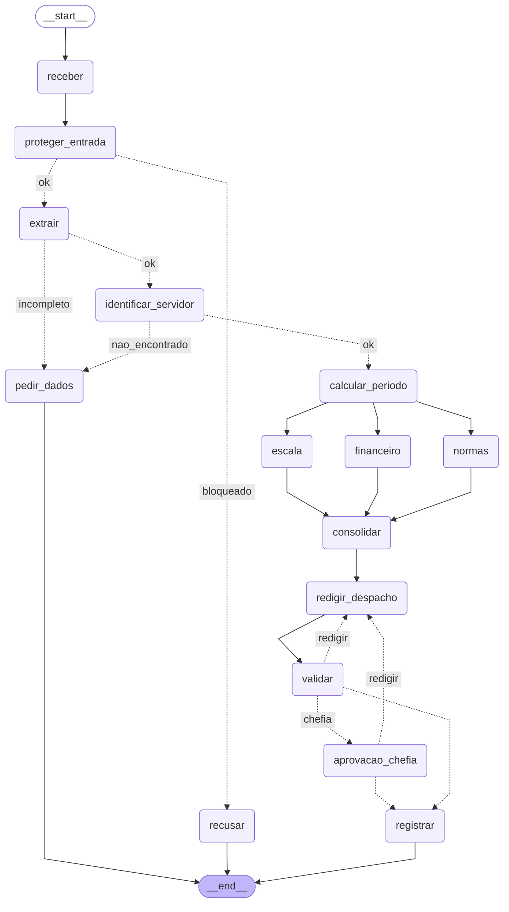

# Entrega: Assistente de Gestão de Pessoas

**Aluno(s):** Guilherme Batista de Castro Matos
**Até onde chegou:** (x) Marco mínimo (Etapa 6) (x) Marco completo (Etapa 9) (x) Etapas 10-11.
**Opcionais implementados:** (x) A (x) B (x) C; A/C desligados por padrão.

**Validação concluída em 13/10/2026 com OpenAI `gpt-4o-mini`.**

O ambiente respondeu `PRONTO`; o verificador original passou nas etapas 0-11 e nos opcionais.
Com `--llm`, as conferências de agente, extração, classificador e fluxo linear usam o modelo real;
as conferências estruturais do grafo continuam usando respostas fixas por desenho do professor.
Por isso também executei os **12 casos com agentes, MCP e SQLite reais**, sem mocks, e retomei
C2/C11 em outros processos. As decisões de chefia e de triagem foram **simuladas para os dados fictícios**.
Os **13 testes adicionais** passaram, incluindo regressões dos defeitos encontrados nas chamadas reais.

Resultados finais: `evidencias/conferir_llm_final.txt`, `evidencias/casos_llm.json`,
`evidencias/testes_integracao.txt` e `evidencias/VALIDACAO_REAL.md`.
A versão inicial sem LLM está preservada como evidência estrutural, com nomes `_sem_llm`.

## Etapa 0: quem verifica cada regra?

| Regra | Tema | Quem verifica (função Python / agente / humano) | Por quê | Onde foi implementada |
|---|---|---|---|---|
| N1 | férias | função Python; Normas explica | mínimo de 5 dias e saldo; dados não contêm histórico completo dos 3 períodos | etapa06_regras.violacoes_objetivas |
| N2 | férias | função Python; Financeiro explica | limites de venda e saldo, conta monetária com Decimal | etapa06_regras; calculos_financeiros.venda |
| N3 | férias | função Python | início e dois dias seguintes devem ser úteis | etapa04_ferramentas.inicio_permitido |
| N4 | prazos | função Python | antecedência em dias corridos ou úteis | etapa06_regras.violacoes_objetivas |
| N5 | escala | função Python; Escala sugere alternativas | limite da equipe e afastamentos; foi preservada a conferência objetiva fornecida pelo professor | dados_rh.escala_da_equipe; etapa06_regras |
| N6 | abono | função Python | dia útil, saldo e pedido de um só dia | etapa06_regras; etapa07_grafo.rotear_extracao |
| N7 | diária | função Python; Financeiro explica | pernoites + meia diária, valor e câmbio, sem inventar cotação | calculos_financeiros.diarias; etapa04_ferramentas.cotacao_usd_brl |
| N8 | aprovação | humano; server confere autorização | chefia decide; cadastro define quem pode aprovar | etapa07_grafo.aprovacao_chefia; etapa05_mcp_rh.registrar_decisao |
| N9 | saúde | função Python e agente classificador | regex barra CPF/CID antes do LLM; classificador cobre licença de saúde escrita sem código | etapa03_guardrails; etapa07_grafo.proteger_entrada |
| N10 | dados | função Python; Redator orientado | despacho com CPF/CID não é gravado; instruções proíbem saúde e salário-base | etapa07_grafo.validar e registrar |

## Etapa 11: os 12 casos

Resultados **observados com o modelo real**, partindo de saídas novas em
`saidas_validacao_real_finalizada`. C2 passou por rejeição com feedback, nova redação e aprovação 1010;
C11 foi aprovado pela 1011. `trio` representa Normas/Escala/Financeiro em paralelo.

| Caso | Caminho percorrido | Resultado | Bateu com o esperado? |
|---|---|---|---|
| C1_abono_simples | receber -> proteger_entrada -> extrair -> identificar_servidor -> calcular_periodo -> trio -> consolidar -> redigir_despacho -> validar -> registrar | registrado (deferido) ae788d33 | sim, OpenAI real |
| C2_ferias_com_venda | receber -> proteger_entrada -> extrair -> identificar_servidor -> calcular_periodo -> trio -> consolidar -> redigir_despacho -> validar -> aprovacao_chefia -> redigir_despacho -> validar -> aprovacao_chefia -> registrar | pausou, revisou e retomou: registrado (deferido) b7b6f485 | sim, OpenAI real |
| C3_dado_de_saude | receber -> proteger_entrada -> recusar | recusado | sim, OpenAI real |
| C4_fora_do_escopo | receber -> proteger_entrada -> recusar | recusado | sim, OpenAI real |
| C5_sem_matricula | receber -> proteger_entrada -> extrair -> pedir_dados | pediu_dados | sim, OpenAI real |
| C6_conflito_de_escala | receber -> proteger_entrada -> extrair -> identificar_servidor -> calcular_periodo -> trio -> consolidar -> redigir_despacho -> validar -> registrar | registrado (indeferido) 6f1b47d7 | sim, OpenAI real |
| C7_autoaprovacao | receber -> proteger_entrada -> recusar | recusado | sim, OpenAI real |
| C8_idempotencia | receber -> proteger_entrada -> extrair -> identificar_servidor -> calcular_periodo -> trio -> consolidar -> redigir_despacho -> validar -> registrar | duplicado (deferido) ae788d33 | sim, OpenAI real |
| C9_divergencia | receber -> proteger_entrada -> extrair -> pedir_dados | pediu_dados | sim, OpenAI real |
| C10_zona_cinzenta | receber -> proteger_entrada -> extrair -> pedir_dados | pediu_dados | sim, OpenAI real |
| C11_diaria_exterior | receber -> proteger_entrada -> extrair -> identificar_servidor -> calcular_periodo -> trio -> consolidar -> redigir_despacho -> validar -> aprovacao_chefia -> registrar | pausou e retomou: registrado (deferido) ec67dba1 | sim, OpenAI real |
| C12_inicio_proibido | receber -> proteger_entrada -> extrair -> identificar_servidor -> calcular_periodo -> trio -> consolidar -> redigir_despacho -> validar -> registrar | registrado (indeferido) 7c458e62 | sim, OpenAI real |

C8 não gerou outra gravação: são cinco registros únicos para os 12 casos. C3 consumiu zero tokens,
pois a regex impediu a chegada ao modelo. C9 manteve início/fim null; C10 teve nota 0,55 e pediu datas exatas.
As alternativas calculadas no estado são: C6, 20/07 a 03/08/2027, após o afastamento existente;
C12, 03/05 a 17/05/2027, início permitido N3. Ambas têm 15 dias corridos.

C2: 15 dias corridos gozados + 10 vendidos; venda de **R$ 3.166,67**. C11: três pernoites + meia diária,
**USD 1.120,00**, com cotação observada **4,9923**, resultando em **R$ 5.591,38**.
O retorno da viagem é 11/06/2027; o retorno ao trabalho calculado é 14/06/2027.

## O grafo



O fan-in usa `add_edge(["normas", "escala", "financeiro"], "consolidar")`.
`violacoes` e `caminho` usam reducers; cada ramo escreve seu próprio parecer.
O ciclo de redação termina em três validações por versão; a chefia pode rejeitar duas vezes.
Após o limite, despacho inválido não é registrado; duas rejeições registram indeferimento pela chefia.

## Etapa 4 (pronta): o que eu entendi

- Online: BrasilAPI e Frankfurter responderam na verificação do ambiente. O script da etapa 4 foi executado
  nos dois modos, com seus valores documentados em `evidencias/etapa04_online.txt` e `etapa04_offline.txt`.
  A API retornou 14 feriados de 2027 e cotação 4,9923; o arquivo fornecido contém 13 feriados.
  Isso mostra que a cópia offline pode estar defasada. Nos dois modos, o período C2 teve 10 dias úteis.
- Offline: três tentativas e fallback para os 13 feriados locais de 2027; cotação fica indisponível.
- A espera dobra para dar tempo à fonte de recuperar e evitar bombardear o serviço: 0,5 s e 1 s antes da terceira tentativa.
- O hash normalizado da matrícula, tipo e datas mantém o mesmo protocolo no reenvio; uma sequência geraria outro número.
- Sem cache, as funções de calendário consultariam a API a cada dia, aumentando latência, chamadas e risco de limite.
- Mantive a Etapa 4 original. Sua simulação `FERIADOS_OFFLINE=1` também faz a cotação falhar;
  o fallback local cobre apenas 2027. A política real para outros anos exigiria catálogo completo ou negar na ausência da fonte.

## Observabilidade (C2)

Medição real, incluindo a revisão após rejeição da chefia:

```json
{
  "nos": [
    "receber",
    "proteger_entrada",
    "extrair",
    "identificar_servidor",
    "calcular_periodo",
    "escala",
    "normas",
    "financeiro",
    "consolidar",
    "redigir_despacho",
    "validar",
    "aprovacao_chefia",
    "aprovacao_chefia",
    "redigir_despacho",
    "validar",
    "aprovacao_chefia",
    "aprovacao_chefia",
    "registrar"
  ],
  "segundos_total": 24.29,
  "mais_lento": [
    "financeiro",
    5.256639
  ],
  "tokens_total": 8408
}
```

O número de segundos é a soma das durações dos nós, como no agregador do professor.
Com paralelismo, essa soma não equivale ao tempo de parede; a espera humana entre processos não entra nela.
Tokens incluem classificador, extração, especialistas e redações. As pausas/revisões aparecem no rastro.
O wrapper não grava credencial nem salário-base nas métricas.

| Caso | Tokens reais | Soma das durações dos nós (s) |
|---|---:|---:|
| C1 | 5092 | 16.53 |
| C2 | 8408 | 24.29 |
| C3 | 0 | 0.0 |
| C4 | 411 | 1.07 |
| C5 | 1282 | 4.21 |
| C6 | 6003 | 17.1 |
| C7 | 435 | 1.06 |
| C8 | 4458 | 12.72 |
| C9 | 1326 | 2.83 |
| C10 | 1355 | 2.31 |
| C11 | 6706 | 20.07 |
| C12 | 5678 | 15.55 |

Total dos 12 casos desta demonstração: **41154 tokens**. Não inclui as chamadas anteriores de diagnóstico,
o verificador `--llm` e a demonstração dos opcionais; não é o total faturado pela conta.

## Opcionais

- **A:** C1/C2 tiveram unanimidade. Em C9 os três votos mantiveram datas null e dias vendidos 0:
  `divergencia=False`. Concordância sobre informação ausente também é válida: o grafo pede esclarecimentos.
  C9 em paralelo: **1.603 s**, **2789 tokens**.
  C2: **1.649 s** em paralelo e **4.334 s** em sequência;
  ambos consumiram 2790 tokens. Os votos completos estão em `evidencias/votacao_llm.json`.
- **B:** teste real com tentativa forçada de tool: `Coordenador não pode usar consultar_remuneracao`.
  A tool não executou. Com orçamento 1, a segunda chamada foi barrada (`2 de 1`).
  Uma recusa textual do Coordenador não foi considerada prova do hook; `tool_choice` força a tentativa adversarial.
  Saída em `evidencias/governanca_llm.txt`.
- **C:** nota real de C10 **0,55**, entre os limiares 0,4 e 0,8. Com recusa do atendente,
  `receber -> proteger_entrada -> triagem_humana -> recusar`. Com concordância,
  `receber -> proteger_entrada -> triagem_humana -> extrair -> pedir_dados`, mantendo datas null.
  Evidência em `evidencias/triagem_llm.json`. A/C seguem desligados no fluxo padrão dos 12 casos.

## Correções após testar o modelo real

1. O extrator inventou início do mês quando faltava o dia: exemplos negativos explícitos e temperatura zero;
   C5/C9/C10 passaram a manter datas null na validação final.
2. Pareceres aplicavam N3 ao abono e inventavam conflitos/sugestões: instruções por tipo e lista objetiva
   de violações com precedência. Alternativas N3/N5 foram calculadas em Python e conferidas no despacho.
3. O Redator confundiu dias úteis com dias gozados: contas com campos explícitos de dias corridos e
   validação que devolve o despacho para revisão quando essa confusão aparece.
4. O modelo fez afirmações contraditórias de autorização: o status N8 passou a ser declarado pela aplicação,
   removendo linhas de autorização do modelo. Abono válido dispensa chefia; férias/diárias ficam como minuta
   até a aprovação. Após a resposta humana, o registro indica a ratificação da chefia.
5. O classificador recusou C9 em uma execução anterior: instrução explícita de que pedido vago de RH
   continua no escopo e temperatura zero. C9 pediu dados na execução final.

As chamadas anteriores são histórico de diagnóstico. Os resultados finais estão nos arquivos selecionados
em `evidencias/VALIDACAO_REAL.md`. Um teste real é evidência dessa execução, não garantia universal
para qualquer texto ou versão futura do modelo.

## Reflexão (até 3 linhas cada)

1. O LLM interpreta o pedido e redige; o grafo controla sequência, paralelismo e ciclos. Python decide violações
   objetivas (C6/N5); o humano aprova C2/C11 ou decide a triagem opcional de C10.
2. O server exige token de escrita, proíbe aprovador igual à matrícula e confere a chefia do cadastro.
   Um texto “eu aprovo” não muda o cadastro nem autoriza a operação.
3. Na retomada, o nó executa novamente desde o início. Gravar antes de `interrupt()` repetiria o efeito;
   a única gravação de negócio fica no nó registrar, após a resposta humana.
4. MCP fornece cadastro, normas, escala, remuneração e tabela de diárias. APIs fornecem feriados/câmbio;
   tools/funções locais fazem calendário, contas e hash. O contrato desacopla fonte, interpretação e execução.
5. Usaria identidade autenticada para a chefia, permissões no server também na leitura, transações,
   calendário completo, histórico de férias e idempotência mais abrangente; sessões MCP persistentes e avaliação com LLM real.
6. A: votação vale para pedidos com risco de extração ambígua; triplica chamadas. Para pedido incompleto,
   pedir esclarecimento pode ser suficiente e mais barato.
7. B: guardrail filtra texto de entrada/saída; hook controla o loop antes de tools; server autoriza a gravação
   mesmo se alguém chamar a tool diretamente, contornando o agente.
8. C: na entrada, o atendente decide se o texto deve tramitar. Na saída, a chefia decide sobre um despacho
   já analisado. São responsabilidades e pontos de pausa distintos.

## De onde veio cada parte

| Arquivo / trecho | Exemplo das aulas em que me baseei | O que precisei adaptar |
|---|---|---|
| etapa01_agente | aula1/segundo_agente.py; exercicios_resolvidos/aula4/ex10_function_tool.py | consulta matrícula sem salário, docstring e uso seletivo |
| etapa02_extracao | aula2/agente_output.py e agente_output2.py | Pedido com enums, datas null e dias vendidos |
| etapa03_guardrails | aula2/agente_guardrail.py; aula8/exemplos/04_prompt_injection | escopo RH, saúde e tentativa de autoaprovação; regex antes do modelo |
| etapa04_ferramentas | aula3/agente_retry2.py, retry3.py, retry4.py; aula6/exemplos/11_grafo_real | peça pronta do professor preservada |
| etapa05_mcp_rh e cliente | aula6/desafio2/mcp_unidades.py; aula5/exemplos/04_agente_mcp e 10_seguranca | seis tools RH, dict único, autorização N8 e JSONL |
| etapa06_agentes e linear | aula4/ex03_agente_as_tool.py; aula7/exemplos/02_agentes_especializados | Normas, Escala, Financeiro e Redator com privilégio mínimo |
| etapa06_regras | aula6/exemplos/11_grafo_real; aula6/desafio3 | peça pronta do professor preservada |
| etapa07_grafo | aula6/desafio2; aula7/exemplos/08_paralelismo, 04_persistencia, 06_human_in_the_loop, 07_aprovacao_revisao | fan-in por lista, ciclos limitados, SQLite e matrícula de chefia |
| etapa10_governanca/observabilidade | aula3/agente_hook2.py e hook3.py; aula8/exemplos/03_observabilidade | permissões, orçamento, tempo/tokens JSONL por nó |
| calculos_financeiros | princípios das aulas 1/6: cálculo em Python, LLM explica | N2/N7 com Decimal, dados obtidos pelo papel Financeiro |
| tests | estratégia de LLM fixo do conferir.py da aula10 | testes de efeitos reais, persistência e regressões encontradas com OpenAI |
| sugestoes_periodo e redacao_segura | aulas 6/8: regra em código e guardrail de saída | alternativas N3/N5 e status N8 independente do texto do modelo |
| validar_modelo_real | roteiro da etapa 11 e observabilidade da etapa 10 | coleta de checkpoints e demonstração real de votação/triagem, sem mocks |

Fonte: [repositório do professor](https://github.com/franciscomduarte/material-pcdf), commit
`0203c324f544a9bb541679356f6bf86bd4c1c034`. O código-base, dados e verificadores foram fornecidos pelo professor;
as lacunas foram implementadas com assistência do Codex. Não foram desenvolvidas atividades das outras aulas.

## Limites do protótipo

Preservei as regras objetivas disponibilizadas para compatibilidade com o exercício. Elas não modelam histórico
dos três períodos N1, nem a concorrência diária completa de afastamentos N5. O hash original considera quatro
campos e pode tratar uma alteração de venda/destino nas mesmas datas como duplicado. Os arquivos JSON não
substituem transações de banco para gravações simultâneas. A matrícula digitada da chefia é identificação
didática, não autenticação. A regex não identifica toda informação de saúde em linguagem natural.
Esses limites não foram apresentados como controles de produção.
